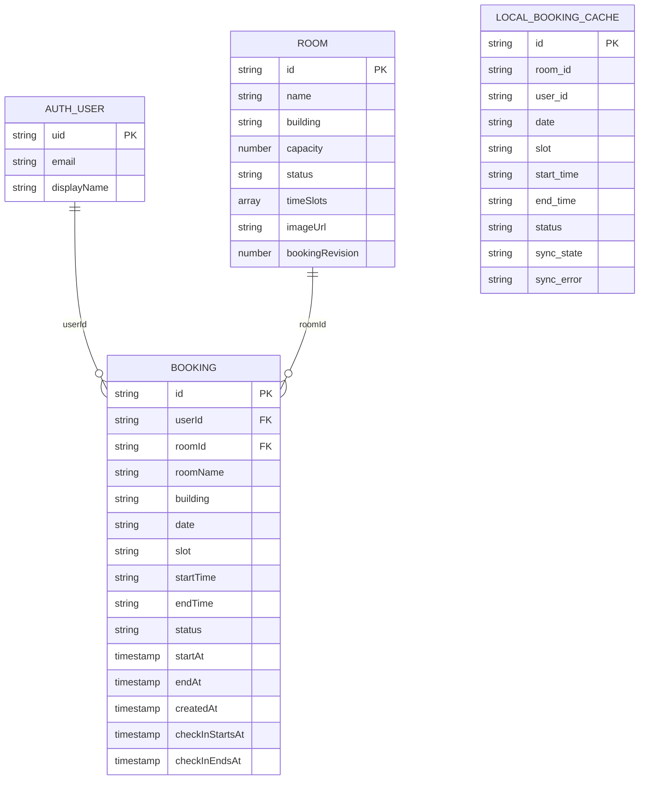

# KIẾN TRÚC CHI TIẾT VÀ TRIỂN KHAI TÍNH NĂNG CỐT LÕI

**Khóa học:** Phát triển ứng dụng di động đa nền tảng  
**Tên dự án:** Đặt Phòng Học (Study Room Booking)  
**Tên nhóm:** DragonFly • **Học kỳ:** Học kỳ 1 (2026–2027) • **Hạn chót:** Tuần 8

---

## 1. TRIỂN KHAI KIẾN TRÚC SẠCH

Dự án tổ chức mã nguồn theo các lớp presentation, domain và data. Các dịch vụ Firebase, SQLite và ML Kit được gọi từ lớp data/service hoặc thông qua repository/use case để tránh đặt toàn bộ nghiệp vụ trong màn hình.

| Lớp | Thành phần trong dự án | Trách nhiệm |
|---|---|---|
| **Presentation** | `src/screens/`, `src/components/`, `src/navigation/`, `src/context/`, `src/presentation/theme/` | Hiển thị màn hình, điều hướng, quản lý trạng thái giao diện và cung cấp trạng thái dùng chung qua `AppStateContext`. |
| **Domain** | `src/domain/Entities/`, `src/domain/Repositories/`, `src/domain/UseCases/` | Định nghĩa entity `Booking`, hợp đồng repository và use case như `CreateBooking` / `ScanIdCardUseCase`. |
| **Data** | `src/data/DTOs/`, `src/data/Mappers/`, `src/data/repositories/` | Chuyển đổi giữa entity và DTO; triển khai repository booking bằng SQLite và đồng bộ với Firestore; thực hiện OCR qua ML Kit. |
| **Services / Config** | `src/services/`, `src/config/` | Truy cập Firestore, xác thực Firebase, nhắc lịch, đặt phòng và các thao tác nghiệp vụ từ xa. |

### Luồng tạo booking và quản lý trạng thái

1. Màn hình gọi hành động từ `useAppState`; `AppStateContext` lấy UID của người dùng đang đăng nhập.
2. `CreateBooking` xác thực thông tin phòng, ngày, khung giờ và thời gian kết thúc.
3. `LocalBookingRepositoryImpl` tạo ID booking, ghi bản ghi vào SQLite với `sync_state = 'pending'`, rồi thử đồng bộ nếu thiết bị đang có mạng.
4. Khi kết nối được khôi phục, NetInfo kích hoạt đồng bộ booking đang chờ. Repository kiểm tra phòng, sức chứa và booking có thời gian giao nhau trước khi ghi lên Firestore; khi thành công, bản ghi chuyển sang `synced`.
5. Khi tải dữ liệu người dùng, booking từ Firestore được ánh xạ vào entity và cập nhật cache SQLite. `AppStateContext` cung cấp dữ liệu cho các màn hình và đăng ký lắng nghe thay đổi booking.

### Quản lý trạng thái

Dự án sử dụng **React Context và React Hooks** (`useState`, `useEffect`, `useMemo`, `useCallback`) trong `AppStateContext`; đây là bộ điều khiển trạng thái đang triển khai, không phải Zustand hoặc Riverpod. Giao diện và dữ liệu booking có luồng trạng thái riêng; chế độ sáng/tối được quản lý bởi `AppThemeProvider` và lưu lựa chọn bằng AsyncStorage.

---

## 2. SƠ ĐỒ CƠ SỞ DỮ LIỆU VÀ CHÍNH SÁCH BẢO MẬT

### Sơ đồ quan hệ logic

Firestore lưu dữ liệu từ xa trong hai collection `rooms` và `bookings`. `userId` là Firebase Authentication UID; `roomId` là tham chiếu logic tới phòng, không phải quan hệ khóa ngoại được Firestore cưỡng chế. SQLite lưu bản cache booking trên thiết bị.

#### Collection `rooms`

- Document ID là `roomId`.
- Các trường chính: `name`, `building`, `capacity`, `status`.
- Có thể có `timeSlots`, `imageUrl` và `bookingRevision`.
- `bookingRevision` tăng khi có thao tác booking liên quan, hỗ trợ các giao dịch phối hợp cập nhật phòng.
- `bookingCount` trong giao diện được tính từ booking theo ngày/khung giờ, không phải trường lưu cố định trong document phòng.

#### Collection `bookings`

- Document ID là mã booking; các trường nghiệp vụ gồm `userId`, `roomId`, `roomName`, `building`, `date`, `slot`, `startTime`, `endTime`, `status` và tùy chọn `seatNumber`.
- Khi tạo booking, Firestore lưu thêm `startAt`, `endAt`, `createdAt`, `checkInStartsAt`, `checkInEndsAt` để phục vụ kiểm tra thời gian và check-in.
- Trạng thái ứng dụng gồm `CONFIRMED`, `IN_USE`, `COMPLETED`, `NO_SHOW`.

#### Bảng SQLite `bookings`

- Lưu dữ liệu booking cục bộ với khóa chính `id`, các trường phòng/người dùng/thời gian/trạng thái và `seat_number`.
- `sync_state` nhận `pending` hoặc `synced`; `sync_error` lưu lỗi đồng bộ gần nhất.
- Có index theo `(user_id, date)` và `sync_state`.

### Chính sách bảo mật

Dự án sử dụng **Cloud Firestore Security Rules**, không dùng RLS của Supabase. Tóm tắt các quy tắc hiện có trong `firestore.rules`:

- Đọc collection `rooms` và `bookings` yêu cầu người dùng đã đăng nhập.
- Tạo booking chỉ được phép khi `userId` trong dữ liệu bằng UID đang đăng nhập và các trường/thời gian hợp lệ; thao tác phải đồng thời tăng `bookingRevision` của phòng.
- Chủ booking có thể hủy booking còn ở trạng thái được phép; cập nhật check-in phụ thuộc vào quyền chủ booking, custom claim `scanner` hoặc `admin`. Gia hạn chỉ dành cho chủ booking đang sử dụng phòng.
- Quyền quản trị phòng phụ thuộc custom claim `admin`; các quyền scanner/admin được đọc từ custom claims trong Firebase Authentication.
- Quy tắc mặc định từ chối các đường dẫn document không được khai báo.

**Lưu ý phạm vi bảo vệ dữ liệu:** quy tắc đọc booking hiện chỉ yêu cầu đăng nhập, chưa giới hạn truy vấn/đọc theo `userId` của người dùng hiện tại. Vì vậy không nên mô tả chính sách hiện tại là đã cách ly dữ liệu booking theo từng người dùng; cần hoàn thiện và kiểm thử Firestore Rules nếu yêu cầu là mỗi người chỉ đọc được booking của mình.

---

## 3. TIẾN TRÌNH TRIỂN KHAI TÍNH NĂNG CỐT LÕI

- **Nhánh / thẻ GitHub M2:** [Điền URL nhánh hoặc tag milestone 2]
- **Video minh họa Giai đoạn 2 (2–3 phút):** [Điền URL video]

### Nội dung video đề xuất

1. **0:00–0:30:** Giới thiệu ứng dụng và đăng nhập.
2. **0:30–1:10:** Chọn ngày/khung giờ, xem phòng và tạo booking.
3. **1:10–1:40:** Mở QR booking và thực hiện check-in.
4. **1:40–2:10:** Minh họa trạng thái booking, hủy hoặc yêu cầu gia hạn.
5. **2:10–2:40:** Trình bày ngắn kiến trúc, SQLite cache và trạng thái đồng bộ; nếu có thể, minh họa booking chờ đồng bộ khi mất mạng.

> Bổ sung ảnh chụp màn hình hoặc liên kết sơ đồ ERD đã xuất nếu giảng viên yêu cầu tài liệu trực quan ngoài sơ đồ Mermaid trong file này.
